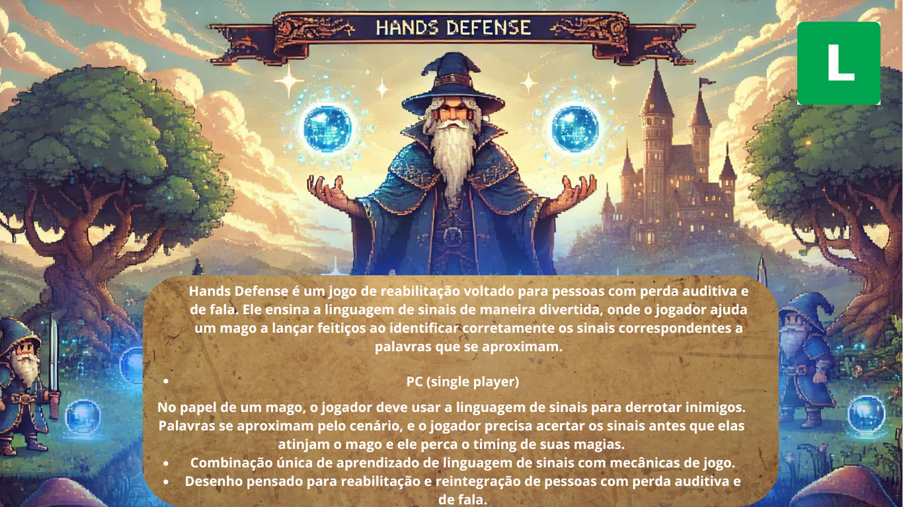

# HandsDefense

[](https://www.python.org)
[](https://www.pygame.org)
[](https://en.wikipedia.org/wiki/Brazilian_Sign_Language)
[](LICENSE)

A 2D defense game that teaches the Brazilian Sign Language (Libras) alphabet: read the word spelled in hand signs and type it to stop each enemy.

<p align="center">
  
</p>

## Table of Contents

- [About](#about)
- [How to Play](#how-to-play)
- [Built With](#built-with)
- [Getting Started](#getting-started)
- [Documents](#documents)
- [Team](#team)
- [License](#license)

## About

HandsDefense was built for the Digital Games course at Universidade Presbiteriana
Mackenzie (2024). The idea is to make fingerspelling practice part of the action:
skeletons, werewolves, mages and a final boss advance toward the player, and each one
carries a word shown only as Libras hand signs. Reading the signs fast enough is the
only way to survive. The game text is in Portuguese.

## How to Play

- Press Enter on the title screen, then pick a difficulty: Fácil, Normal or Difícil.
- Each enemy shows a word as a sequence of Libras hand signs.
- Type the word on the keyboard to defeat the enemy before it reaches you.
- Reach the target score to unlock the next difficulty; the boss appears on Difícil.
- Press Space to pause and open the **Libras** chart to review the alphabet.

## Built With

- Python 3 and Pygame
- Sprite-sheet animations for enemies, the player, explosions and the boss
- A state machine for the start screen, menu, game, pause, game over and victory

## Getting Started

Requirements: Python 3.10+.

```bash
git clone https://github.com/EnzoFerroni/HandsDefense.git
cd HandsDefense
pip install pygame
python HandsDefenceMain.py
```

Run it from the repository root so the `Imagens/` and `Fontes/` paths resolve.

## Documents

- Gameplay video: [`Documentos/DemonstracaoHandsDefence.mp4`](Documentos/DemonstracaoHandsDefence.mp4)
- Short paper: [`Documentos/ShortPaperAtualizado.pdf`](Documentos/ShortPaperAtualizado.pdf)
- One-page design document: [`Documentos/OnePageDocument.png`](Documentos/OnePageDocument.png)

## Team

| Name | GitHub |
| --- | --- |
| Enzo Ferroni | [@EnzoFerroni](https://github.com/EnzoFerroni) |
| Leonardo Rodrigues | [@Leo-RH](https://github.com/Leo-RH) |
| Mateo Zanette | [@MateoZanette](https://github.com/MateoZanette) |
| Pedro Andrade | [@PedrodeAndradecf](https://github.com/PedrodeAndradecf) |
| Rafael Neves | |

## License

Code released under the [MIT License](LICENSE). Copyright (c) 2024 Enzo Ferroni,
Leonardo Rodrigues, Mateo Zanette, Pedro Andrade and Rafael Neves. Sprites and fonts
are third-party assets and keep their original licenses.
